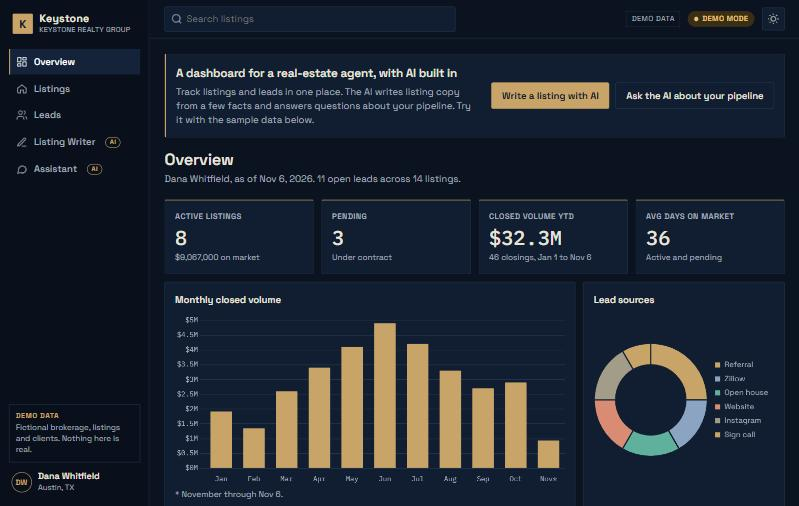
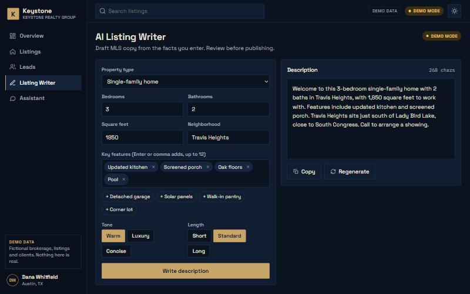
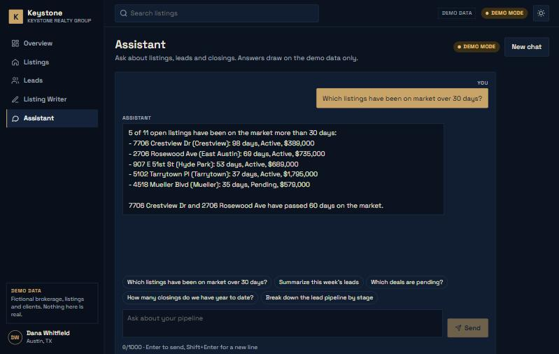
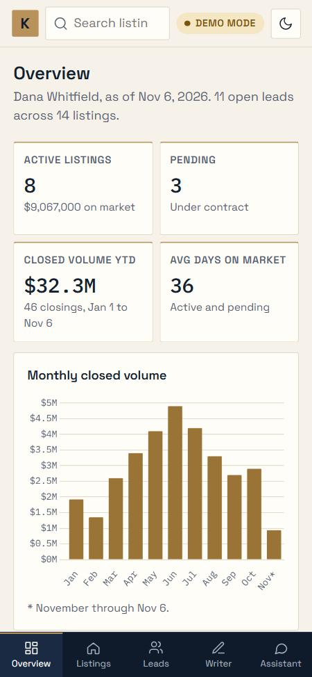

# Keystone: AI dashboard for real-estate agents

A SaaS-style dashboard for a fictional Austin real-estate agent. It tracks listings and leads, and includes an **AI listing writer** and an **AI assistant** that answers questions about the pipeline. The AI runs through a secure serverless API, and the live demo works with or without an API key.

**Live demo:** https://keystone-realty-ai.vercel.app



| AI listing writer | AI assistant | Phone, light mode |
|---|---|---|
|  |  |  |

## Features

- **Overview dashboard:** KPI cards computed from the data, plus three Chart.js charts (monthly closed volume, lead sources, price vs days on market) that re-theme instantly.
- **Listings:** sortable, searchable, filterable table on desktop, switching to cards on phones.
- **Leads pipeline:** five stages (New → Closed). Leads move with keyboard-friendly controls and are saved in the browser.
- **AI listing writer:** enter beds, baths, size, neighborhood, features and tone, and get MLS-ready copy streamed in word by word, with Copy and Regenerate.
- **AI assistant:** chat that answers from the actual listings and leads (including your stage changes), with suggested questions and streaming replies.
- **Dark / light mode:** follows the system setting, remembered, with no flash on load.
- **Accessibility:** skip link, screen-reader announcements for streaming answers, visible focus, WCAG AA contrast in both themes.

## How the AI is built

- The browser calls the app's own API routes (`/api/generate`, `/api/chat`). Only the server talks to the AI provider, so **the API key is never sent to the browser**.
- Provider: [Groq](https://console.groq.com) free tier (GPT-OSS 120B by default; any Groq model via `GROQ_MODEL`), called through its OpenAI-compatible streaming API. Swapping to OpenAI, Claude or Gemini means changing one server file.
- **Demo mode:** with no key, or if the free limit is reached, the API streams realistic answers built from the demo data. The badge in the top bar shows **Demo mode** or **Live AI**.
- **Abuse protection:** input size limits, history checks, and per-IP and global rate limits.

## Tech stack

- Next.js 15 (App Router) + React 19
- Chart.js via react-chartjs-2
- Next.js route handlers as serverless functions on Vercel
- Groq API (free tier), with a built-in demo fallback
- Fonts: Space Grotesk + IBM Plex Mono via `next/font`

## Run locally

Needs [Node.js](https://nodejs.org) 18.18 or newer. In PowerShell:

```powershell
npm install
npm run dev
```

Open http://localhost:3000. Without a key the AI runs in demo mode.

To use live AI, get a free key at https://console.groq.com (no credit card), then create a file named `.env.local` in the project folder:

```
GROQ_API_KEY=your_key_here
GROQ_MODEL=openai/gpt-oss-120b
```

`.env.local` is ignored by git. Never commit your key.

## Deploy on Vercel (free)

1. Import this GitHub repo at https://vercel.com/new. Vercel detects Next.js automatically.
2. Optional: in **Settings → Environment Variables**, add `GROQ_API_KEY` (and `GROQ_MODEL` if you want another model), then redeploy.
3. Without the variable, the site stays in demo mode and costs nothing.

## Notes

Keystone Realty Group, Dana Whitfield, and all listings and leads are fictional. Photos are from [Unsplash](https://unsplash.com).
